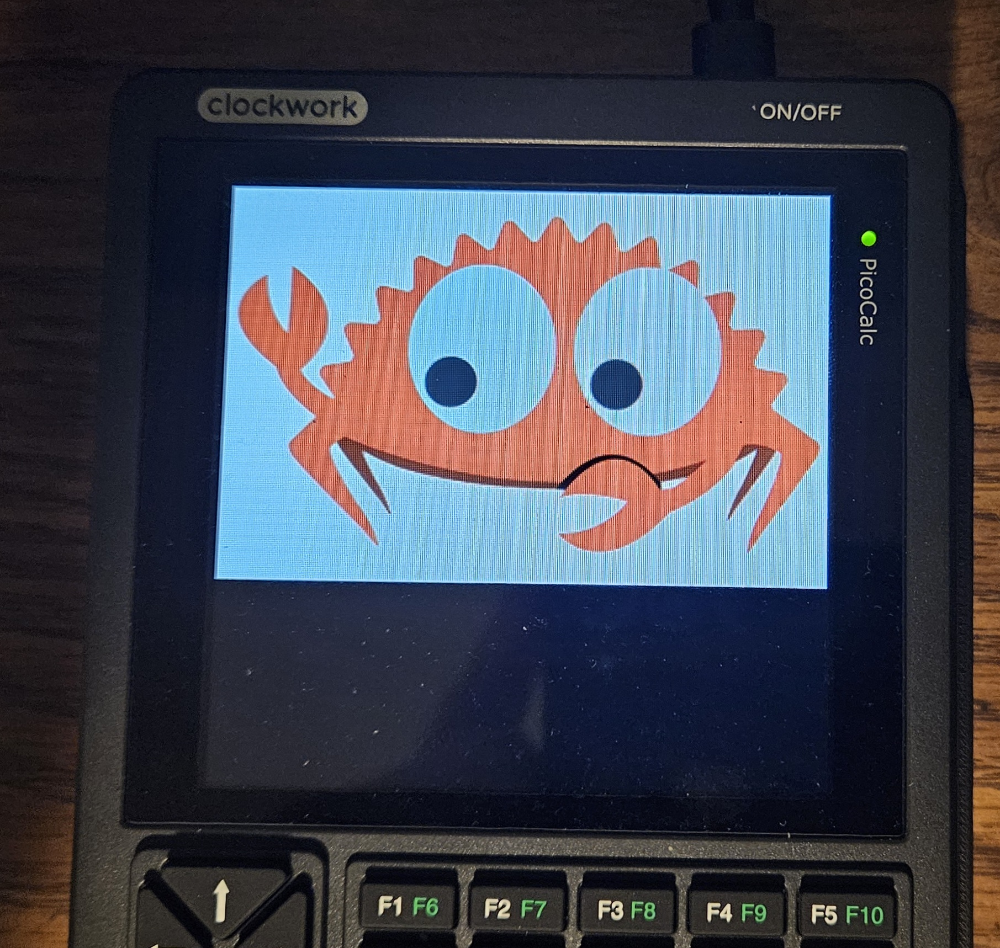

# ST7365P-lcd-rs

This is a Rust library for displays using the ST7365P driver with embedded_graphics, embedded_hal, and no_std, no_alloc support.

Two versions:
- Synchrouous (which is in master branch)
- Asynchronous `branch = "async"`

## Scan synchronization (async branch)

`display.wait_for_vsync(max_polls).await` polls **GSCAN (0x45)** until
the physical scanline counter wraps. Call it immediately before a framebuffer
flush, once per update, not once per tile. It does not require TE output to be
enabled. `read_scanline()` also exposes the counter for diagnostics.

The old experimental read split the command and response across two SPI
transactions, deasserting CS between them. Reads now keep CS asserted throughout,
with D/C low, and decode two MSB-first serial bytes. The dummy read in the parallel
command table is not an extra serial byte. The extra serial dummy clock shown for
RDDID/RDDST is specific to those commands, not GSCAN.

**SPI reads need a slower clock than writes.** The datasheet specifies a minimum
150 ns read clock period (6.66 MHz maximum) and 60 ns high/low times. Use 6 MHz or
less. `SpiDevice` has no portable clock configuration API; `spi_mut()` provides
access to your HAL's configuration. With the example's Embassy `ExclusiveDevice`:

```rust,ignore
config.frequency = 6_000_000;
display.spi_mut().bus_mut().set_config(&config);
let sync = display.wait_for_vsync(2_000).await;
config.frequency = 32_000_000;
display.spi_mut().bus_mut().set_config(&config);
sync.unwrap(); // Or handle VsyncError::Timeout / VsyncError::Interface.
framebuffer.partial_draw_batched(&mut display).await.unwrap();
```

Restore the write clock even when synchronization fails. The PicoCalc example
logs failures and falls back to unsynchronized drawing rather than hanging.
The existing 32 MHz write clock is empirical, not a datasheet-rated guarantee
(the documented write period is at least 66 ns).

- Stock PicoCalc V2.0 connects LCD SDO to GP12, but leaves TE unconnected. Use
  scanline polling there, not a made-up GPIO for TE. The panel must be awake.
- Polls are spaced by at least 50 us, plus SPI overhead. A 2,000-read budget
  allows roughly 100 ms of polling delays. Constant zero or all-one responses
  time out; check MISO wiring, SPI mode/speed and sleep state. A stalled HAL call
  still needs an application-level wall-clock timeout.
- Scanline zero starts vertical sync. Counts include porches and can exceed the
  visible height. Polling detects a wrap, not an exact zero sample; it can return
  shortly after vertical blanking starts, rather than precisely on its edge.
- Starting in sync does **not** guarantee tear-free uploads: a 320x320 RGB565
  frame takes at least 51.2 ms at 32 MHz, longer than a 60 Hz frame (16.7 ms).
  Prefer small dirty updates; matching scan/write order and avoiding the panel
  catching the writer still matter. No automatic waits are added to existing
  drawing methods, and panel refresh settings are left unchanged.

For boards with TE physically connected, `set_tear_scanline(line).await` sends
**STE (0x44)** with a big-endian line number. Line zero selects vertical-only TE,
equivalent to **TEON (0x35), TEM=0**. This programs an output signal, not a delayed
RAM write. It takes effect next frame; await a fresh TE edge in your application
before uploading, with a timeout. `disable_tearing_effect()` sends **TEOFF (0x34)**.
Choose a physical line within the configured panel scan period; rotation does
not convert framebuffer coordinates into TE timing.

References: ST7365P specification V1.0, sections 7.4.3 (SPI timing), 8.4.2
(4-wire serial reads), 9.2.35/9.2.36 (STE/GSCAN), and 10.8 (tearing examples),
plus `clockwork_Mainboard_V2.0_Schematic.pdf` in `clockworkpi/PicoCalc`.
Host checks cover command framing and polling behavior; panel timing still needs
verification on real hardware.

Run host regression checks with `cargo test -p st7365p-lcd --test scan_sync`.

## Drawing and flushing

`FrameBuffer<W, H, SIZE>` uses `DefaultPixelStorage<SIZE>` (an owned `[u16; SIZE]`)
by default; `FrameBuffer::new()` and `framebuffer!(W, H)` remain unchanged.
Use `FrameBuffer::<W, H, SIZE, _>::with_storage(&mut pixels[..])` to borrow an
existing pixel allocation instead. Attached storage starts entirely dirty;
the default zero-filled constructor preserves its initially clean state.

Both backends share clipping, drawing, dirty tracking and every flush method.
Arrays and mutable slices implement `PixelStorage` through `AsRef<[u16]>` and
`AsMut<[u16]>`, including bulk fill/copy and zero-copy transfers. Custom backends
implement `len`, `read`, and `write`; default bulk operations use those methods.
`as_slice` is optional: without it, transfers copy pixels into bounded staging
buffers. Stored words are byte-swapped RGB565, matching the existing buffered
transport; `DrawTarget` handles this conversion for callers.

Do not expose a non-atomic slice over concurrently modified atomic storage.
Storage abstraction does not synchronize dirty tracking or support external
pixel writes: keep all drawing and flushing serialized through the framebuffer.
An atomic backend still needs a separate publication protocol before concurrent
writers can be supported.

The `embedded-graphics::DrawTarget` API and framebuffer flush methods are unchanged.
`draw_iter` and `fill_contiguous` dirty only tiles containing changed pixels.
`fill_solid` and `clear` use bulk fills and still mark their affected tiles dirty.

`partial_draw_batched` streams every dirty run, borrows full-width framebuffer
slices without copying, and uses a full refresh when at least 80% of visible tiles
are dirty. Backends without slices use staged tiles for full refreshes.
Tiles become clean only after a successful transfer; errors or dropped
flush futures leave unsent tiles dirty for retry. Edge tiles use clipped windows
and matching payload lengths. Controller delays remain unchanged; batched address
parameters reduce the number of writes and waits instead.

Run host regression tests with `cargo test -p st7365p-lcd --lib` (also with
`--release`). Actual draw times still require measurements on the target hardware.

### Scan-aware partial updates

Choose the flush API according to latency and tearing requirements:

- `draw`: sends the entire framebuffer immediately, without scan synchronization.
- `partial_draw`: sends dirty 16x16 tiles immediately.
- `partial_draw_batched`: batches dirty tiles for throughput; 80%-dirty frames
  use a full refresh (one transfer when storage exposes a slice).
- `draw_sync`: sends only dirty tiles, checking GSCAN separately before each
  tile. It waits whenever the scan overlaps that tile or would reach it before
  the configured transfer budget expires. This trades throughput and latency
  for reduced local tearing; it never silently falls back to unsynchronized
  drawing, even for an all-dirty frame.

`draw_sync` needs a `ScanSyncConfig` calibrated for your panel and workload.
There are deliberately no guessed refresh-rate, porch, or orientation defaults.
`frame_scanlines` is the counter's full period, not the framebuffer height;
`first_scanline` is the first physical line occupied by this framebuffer,
including porches and display offsets. `direction` describes physical scanning
in framebuffer coordinates after rotation. Recalibrate when changing display
orientation, offsets, refresh settings, SPI speed, or executor load. The mapping
must be contiguous: wrapped hardware scrolling is not supported.

```rust,ignore
use st7365p_lcd::{DrawSyncError, ScanDirection, ScanSyncConfig};

let sync = ScanSyncConfig {
    frame_scanlines: measured_frame_lines,
    first_scanline: measured_first_visible_line,
    direction: ScanDirection::TopToBottom, // Use your verified physical direction.
    write_budget_lines: measured_worst_case_tile_lines + safety_margin_lines,
    max_polls: 2_000,
};

// Reads and writes share one read-safe clock throughout draw_sync.
config.frequency = 6_000_000;
display.spi_mut().bus_mut().set_config(&config);
let result = framebuffer.draw_sync(&mut display, &sync).await;
config.frequency = 32_000_000; // Restore your board's chosen write clock.
display.spi_mut().bus_mut().set_config(&config);

match result {
    Ok(()) => {}
    Err(DrawSyncError::Timeout) => { /* Retry remaining dirty tiles later. */ }
    Err(error) => return Err(error),
}
```

**Timing budget matters.** `write_budget_lines` is a nonzero upper bound on
elapsed scanline periods from the accepted GSCAN sample until the last pixel
of a 16x16 RGB565 tile has arrived. Include the remaining read time, address
commands, SPI transfer, bus contention, async scheduling delays, and margin;
round up. A tile contains at most 512 pixel bytes. The scheduler reserves one
additional line before the next scan visit. Wire speed alone is not a sufficient
budget, and unbounded executor delays cannot be made tear-free by polling.

Each tile requires at least two reads showing counter movement; stuck values
cannot immediately authorize a write. `max_polls` limits reads across the entire
flush, not per tile. Polls within a tile wait are spaced by at least 50 us. A HAL
call that stalls still needs an application-level timeout. Out-of-range counter
values return `InvalidScanline`; impossible geometry or timing budgets return
`InvalidConfig`; transport failures return `Interface`. No dirty tiles means no
SPI activity. Only successfully uploaded tiles become clean, so failures or
dropped futures preserve unfinished work for retry.

This first version uses fixed 16x16 tiles and leaves SPI configuration alone.
Keep the entire call at a read-safe clock; switching between every read and write
is not built in. If an application timeout cancels the future, restore your SPI
clock after that timeout result as well. Prefer `partial_draw_batched` when
latency matters more than tearing.

**Not an atomic frame swap.** Writes may occur before or after the scan passes a
tile, and different tiles may become visible in different refreshes. Large images
can visibly assemble over multiple frames. Accurate timing can reduce tearing
within individual tiles, but cannot guarantee a coherent whole-screen image.
Tests exercise scheduling, all four scan directions, transfer deadlines,
wraparound, clipped tiles, failure, and cancellation. Hardware timing remains
unverified.


